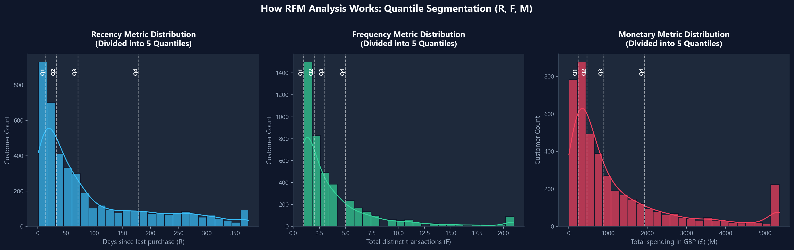
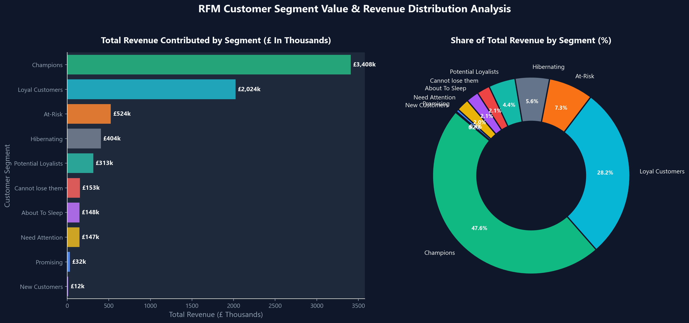

# Retail Customer Insights

A customer segmentation project built from transaction-level online retail data. It uses RFM analysis to describe how recently customers purchased, how often they placed orders, and how much they spent. A Streamlit dashboard makes the resulting segments and purchase patterns easier to explore.

> The results describe historical behavior. They are not a churn prediction, profit estimate, or proof that a marketing campaign will work.

## Project highlights

- Cleans and filters transaction lines using documented purchase rules.
- Calculates customer-level Recency, Frequency, and Monetary measures.
- Scores customers using relative quintiles and assigns readable behavioral segments.
- Compares segment size, purchase behavior, and share of historical sales.
- Examines repeat purchasing and month-by-month cohort activity.
- Provides a dashboard to filter segments, inspect customers, and download a filtered view.

## Visual overview





## Project files

| File | Purpose |
| --- | --- |
| `online_retail_final.csv` | Transaction-level input dataset supplied with this project. |
| `rfm_analysis.ipynb` | Main analysis: data checks, RFM calculations, segment profiles, cohort analysis, charts, and output generation. |
| `app.py` | Streamlit dashboard. Requires the generated CSV outputs below. |
| `requirements.txt` | Python dependencies for the notebook and dashboard. |
| `images/` | Project diagrams and analysis visuals embedded in this README. |

### Generated when you run the notebook

The notebook creates these files in the project folder. They are derived outputs, not additional input datasets, and are ignored by Git because they can be regenerated.

| Generated file | Contents | Used by dashboard? |
| --- | --- | --- |
| `rfm_customers.csv` | One row per customer with RFM values, scores, and segment. | Yes |
| `rfm_segments.csv` | Customer counts, averages, and historical sales by segment. | Yes |
| `rfm_cohorts.csv` | Monthly customer activity by first-purchase cohort. | Yes |
| `campaign_ideas.csv` | Suggested segment-level tests and success measures. | No |

## Getting started

Use Python 3.10 or newer. Open a terminal in the project folder and install the dependencies:

```bash
python -m pip install -r requirements.txt
```

Run the analysis from top to bottom:

```bash
jupyter notebook rfm_analysis.ipynb
```

After the notebook finishes and creates the CSV outputs, launch the dashboard from the same folder:

```bash
streamlit run app.py
```

If the dashboard reports that an export is missing, run all notebook cells first.

## How the analysis is defined

The source file contains transaction line items. The analysis includes a row only when it has a customer ID and valid invoice date, positive quantity and unit price, and an invoice number that does not start with `C`. Line sales are calculated as `Quantity × UnitPrice`. Returns, cancellation invoices, and nonpositive lines are excluded rather than netted against purchases.

- **Recency:** days from the analysis date to the customer’s most recent qualifying purchase. The analysis date is one day after the latest qualifying transaction.
- **Frequency:** number of distinct qualifying invoices per customer.
- **Monetary:** sum of qualifying positive line sales in GBP. This is gross historical sales, not profit or net revenue.
- **RFM scores:** relative quintile ranks within this dataset. Scores and segment sizes may shift when the analysis period or customer population changes.
- **Cohort retention:** share of customers from each first-purchase month who were active in each later calendar month. This is historical description, not a forecast.

## Using the results

Segments are intended to help prioritize questions and campaign tests. For example, a retailer could test a win-back message for less recently active customers or a loyalty benefit for frequent recent customers. To measure whether a campaign caused improvement, use a randomized holdout when possible and track incremental repeat purchase, contribution margin after discounts, and opt-outs.

## Limitations

- This is a descriptive analysis of one historical dataset; it does not predict churn or customer lifetime value.
- No product cost or margin data is included, so sales are not profit.
- Returns are excluded, so Monetary is not net sales.
- Invoice count is used as the frequency measure and may not match every retailer’s business definition of an order.
- Campaign ideas are hypotheses; campaign effectiveness requires a separate evaluation.

## Data attribution

The transaction data is the supplied Online Retail dataset. The preparation choices, RFM scoring, segment definitions, analysis, dashboard, and campaign hypotheses are documented as this project’s work. Preserve the dataset’s original attribution and usage terms when redistributing it.
